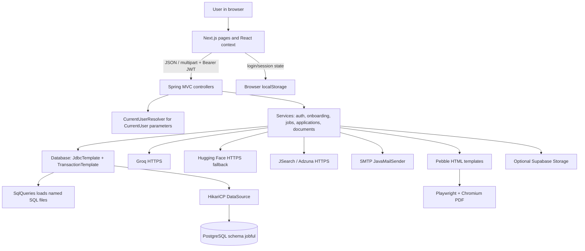

# JobFinder — Java Backend Viva Guide

Source-grounded study guide for the repository as inspected on 26 November 2026. This is intentionally specific to this codebase. Where behavior cannot be established from the checked-in source, it is marked as unconfirmed rather than guessed. Local `.env` files are not included or quoted; never commit them or share their values.

## How to use this guide

Study Parts 1–8 first, then rehearse the six data flows in Part 12. Use the API table and file cheat sheet as maps, not as a substitute for reading code. The 100 viva questions have concise model answers; expand each answer by walking through the linked method. The most likely 40 are listed again at the end.

---

# 1. Project overview

## What problem JobFinder solves

JobFinder brings several job-application activities into one personal workflow: profile setup, CV/resume parsing with a human review step, skill-tag selection, live job search, application tracking, and generation of job-tailored CVs and cover letters. The system’s actual product flows are visible in the Next.js pages and Java REST endpoints; it is not merely an AI chatbot or a job board.

## Main pieces

- **Frontend:** Next.js 15, React 19, TypeScript and Tailwind in `frontend/`; browser UI and API client.
- **Backend:** Java 21 target, Spring Boot 3.5, embedded Tomcat, JDBC and raw SQL in `backend/`.
- **Database:** PostgreSQL. Tables/schema DDL live in `database/schema/setup.sql`; the Java app loads query files from `backend/src/main/resources/sql/`.
- **AI:** Java calls hosted Groq chat completions for CV parsing, job screening and document writing. Job screening falls back to Hugging Face and then a heuristic. This is hosted HTTP usage, not a local model server.
- **CV/PDF:** Apache PDFBox extracts text from uploaded PDFs in memory; Pebble renders HTML; Playwright launches headless Chromium to produce PDFs.
- **Email:** Spring mail starter and `JavaMailSenderImpl` can send verification codes. If SMTP is not configured, code is returned in the verification response (development-friendly, unsuitable for public production).
- **Authentication:** custom JWT implementation plus BCrypt; database-backed refresh sessions with rotation and revocation. No Spring Security web filter chain is used in this implementation.
- **Optional integrations:** JSearch via RapidAPI, Adzuna, Hugging Face, Google OAuth authorization-code flow, and Supabase Storage for rendered PDFs. They need credentials/configuration to work. A standalone ATS CLI scans Greenhouse, Ashby and Lever boards; it is not the normal live-search API path.

## 30-second explanation

> “JobFinder is a job-application workspace. The Next.js frontend calls a Java Spring Boot REST API. The backend uses PostgreSQL through JDBC and named SQL files to store user profiles, CV details, selected skills, tracked jobs and generated documents. It can parse a text-based PDF CV with PDFBox and Groq, search external job providers, and generate tailored HTML documents that users review before compiling to PDF with Playwright and Chromium. Authentication uses BCrypt passwords, signed JWT access tokens and rotating database-backed refresh sessions.”

## Two-minute technical explanation

> “The frontend is a Next.js/React application. Its API helper attaches the saved access token to requests and calls a refresh endpoint when it gets a 401. On the backend, Spring Boot discovers controllers, services, components and configuration under `com.jobfinder`. Controllers map REST routes and accept DTOs; services hold workflow logic; `Database` is a small JDBC layer over Spring’s `JdbcTemplate` and `TransactionTemplate`. SQL is kept as one classpath file per named query, and `Database` binds parameters using prepared statements and converts result sets into ordered maps.
>
> “Users register and verify email before login. Passwords are BCrypt hashes. The custom token service issues short-lived access JWTs and longer-lived refresh JWTs. Refresh-token IDs are stored in PostgreSQL and rotated, and reuse revokes a session. A custom Spring MVC argument resolver validates bearer access tokens and injects a `CurrentUser` into protected controller methods.
>
> “For onboarding, PDFBox extracts selectable text from an uploaded PDF; Groq returns structured JSON which the user reviews and confirms. Confirmed education, experience, projects and tags are written in one transaction. Job search merges JSearch and Adzuna results, then applies deterministic rules and an optional AI gate. Tracked jobs can feed tailored CV and cover-letter drafts. Pebble renders HTML, the user can edit it, and Playwright/Chromium compiles it to PDF. Supabase Storage is optional; the local PDF download can still succeed without successful cloud upload.”

---

# 2. Architecture



## Package map and dependency direction

| Package/folder | Responsibility and representative classes | Direction |
|---|---|---|
| `com.jobfinder` | `JobfinderApplication`: boot entry point | Starts Spring; component scan begins here |
| `config` | `AppSettings`, `DatabaseConfig`, `WebConfig` | Supplies settings, data source, CORS, MVC resolver/interceptor registration |
| `controller` | `AuthController`, `OnboardingController`, `JobController`, `ApplicationController`, `ProfileController`, `HealthController` | HTTP boundary; delegates to services and returns DTOs/maps/bytes |
| `service` | `AuthService`, `CvService`, `JobSearchService`, `ApplicationService`, `DocumentService`, etc. | Business workflows; calls `Database`, clients and other services |
| `security` | `Jwt`, `TokenService`, `PasswordHasher`, `CurrentUserResolver`, `RateLimit*`, `CurrentUser` | Token primitives, password hashing, request identity and per-route limits |
| `db` | `Database`, `SqlQueries`, `SqlLog` | JDBC abstraction, SQL resource lookup/cache, development SQL logging |
| `client` | `Http`, `GroqClient`, `HuggingFaceClient`, `AiClientException` | Outbound HTTP provider boundary |
| `dto` | `AuthDtos`, `CvDtos`, `ApplicationDtos`, `JobDtos`, `OnboardingDtos` | Typed request/response data contracts; Java records are used extensively |
| `web` | `ApiException`, `GlobalExceptionHandler`, `SqlLogFilter` | JSON error translation and response filter |
| `ats` | `AtsScanner` | Independent command-line job board scanner/exporter |
| `backend/src/main/resources/sql` | Named `.sql` files by feature | Database statements consumed by `SqlQueries` |
| `database` | schema, seeds, views, functions | PostgreSQL-owned database definitions and seed data |
| `frontend/services`, `frontend/context`, `frontend/app` | API/auth client, session state and pages | Browser-side UX and calls into REST API |

**Important distinction:** this is layered MVC/service/JDBC code, but it does not use a conventional JPA repository/entity model. `Database` is annotated `@Repository` and acts as a SQL gateway, yet the SQL files—not repository interfaces—define statements.

## Request lifecycle example: confirm a reviewed CV

1. `frontend/app/onboarding/page.tsx` collects edits and calls `confirmCV` in `frontend/services/auth.ts`.
2. The API helper sends JSON and the bearer access token.
3. Spring maps `POST /api/onboarding/confirm-cv` to `OnboardingController.confirmCv`.
4. The `CurrentUser` method parameter is resolved by `CurrentUserResolver`; the resolver validates the token and looks up the user (unless dev auto-login is enabled).
5. The controller delegates to `CvService.confirm`.
6. `CvService` executes a transaction, clears existing CV rows, inserts valid education/experience/project records, reconciles tags, and marks CV uploaded via named SQL queries.
7. DTO response is serialized to JSON (Jackson naming is configured as snake case).
8. Browser handles the result. If the server throws, `GlobalExceptionHandler` maps known exceptions to JSON/status.

The `X-SQL-Log` response header can expose the executed SQL statements during development; `WebConfig` explicitly exposes this header to browser JavaScript.

---

# 3. Backend classes: focused walkthrough

## Entry point — `JobfinderApplication`

`@SpringBootApplication` marks the configuration/auto-configuration/component-scan root. `main` calls `SpringApplication.run(...)`; Spring creates the application context, discovers beans and starts embedded Tomcat. Package location `com.jobfinder` makes its subpackages discoverable by default.

## Configuration

- **`AppSettings`** (`@Component`): loads `.env` lines itself; environment variables take precedence. Its simple parser handles comments and single/double quote pairs; it is not a full dotenv specification. Provides typed/defaulted accessors for database, JWT, CORS, mail, Google, AI, CV, Storage and job-search settings. It caches the file values in a field at bean construction; restart to pick up edits.
- **`DatabaseConfig`** (`@Configuration`, `@Bean`): reads URL/schema, parses URI, builds a JDBC URL, decodes username/password, sets PostgreSQL options and returns `HikariDataSource` as `DataSource`. Detailed line walk is in Part 7.
- **`WebConfig`** (`@Configuration`, `WebMvcConfigurer`): registers `CurrentUserResolver`, `RateLimitInterceptor`, and a highest-precedence `CorsFilter`. CORS allows configured exact origins, credentials, all methods/headers and exposes `X-SQL-Log`.

## Controllers

- **`AuthController`**: `/api/auth`; delegates registration/login/refresh/verification/logout to `AuthService`; injects `CurrentUser` for `/me` and `/session`; redirects Google endpoints via `GoogleOAuthService`; `dev-session` is hidden with 404 unless dev mode is enabled.
- **`OnboardingController`**: `/api/onboarding`; profile/tag and CV routes. Upload verifies content type, size, nonempty bytes and `%PDF` signature before calling `CvService.preview`; confirm delegates reviewed data to transactional storage.
- **`JobController`**: `/api/jobs`; eligible jobs use SQL, live search builds a `JobSearchService.Query`, searches providers, calls `JobFilterService`, then maps results to an allow-listed set of UI fields. Search is limited to 30/minute per address/method.
- **`ApplicationController`**: `/api/applications`; tracking, overview, status, prepare-apply, stale removal, document listing/generation/compilation. Compile returns `application/pdf` bytes with attachment disposition.
- **`ProfileController`**: `/api/profile`; account update, saved CV data and stats.
- **`HealthController`**: `/api/health` returns liveness JSON; `/` says backend is alive and frontend is a separate Next server.

## Services and core collaborators

| Class | Actual role |
|---|---|
| `AuthService` | Registration, login, verification completion, refresh rotation/reuse handling and logout |
| `VerificationService`, `EmailService` | Signed stateless verification challenge and optional SMTP delivery |
| `SessionService`, `TokenService`, `Jwt`, `PasswordHasher` | Refresh-session persistence, token creation/validation and BCrypt |
| `UserAccountService`, `ProfileService` | User lookup/dev-user path and profile/CV/stats access |
| `OnboardingService`, `TagRecommender` | Job-title/bio tag suggestions, assigned/selected tags and profile changes |
| `CvService`, `CvTextExtractor` | PDF text/contact extraction, Groq parsing, normalization, transactional persistence |
| `JobSearchService` | Live JSearch/Adzuna requests, result normalization, dedupe, salary filter |
| `JobFilterService`, `JobGateService` | Rule-first job screening and Groq → HF → heuristic evaluation |
| `ApplicationService`, `JobFreshnessChecker` | Job tracking/status, overview and stale listing checks |
| `DocumentGenerator`, `CvContent`, `TemplateRenderer` | Select relevant CV facts, AI rewriting/fallbacks and Pebble HTML rendering |
| `DocumentService`, `PdfService`, `StorageService` | Draft lifecycle, Chromium PDF compilation and optional Supabase upload/delete |

---

# 4. Spring concepts actually present

| Concept | Where | Meaning/use here; viva angle |
|---|---|---|
| `@SpringBootApplication` | `JobfinderApplication` | Boot configuration + auto-configuration + component scan. Ask what package is scanned. |
| `@Configuration`, `@Bean` | `DatabaseConfig`, `WebConfig` | Java configuration creates managed `DataSource` and `FilterRegistrationBean`. A bean is managed by Spring; `DataSource` is injected elsewhere. |
| `@Component` | `AppSettings`, clients, resolver, `DocumentGenerator`, `TemplateRenderer`, filters | Generic Spring-managed component. |
| `@Service` | workflow classes | Marks business/service components semantically; Spring still treats it as a component stereotype. |
| `@Repository` | `Database` | Persistence stereotype; here it wraps `JdbcTemplate`, not a JPA repository interface. |
| `@RestController` | all API controllers | Controller plus response-body semantics; returned DTOs/maps become JSON via message converters. |
| Constructor injection | throughout controllers/services | Spring resolves constructor arguments from context. Dependencies are explicit and fields are final. No field `@Autowired` usage identified. |
| Mapping annotations | controllers | `@RequestMapping` establishes prefixes; `@GetMapping`, `@PostMapping`, `@PutMapping`, `@DeleteMapping` map HTTP verbs. |
| Parameter binding | controllers | `@RequestBody` JSON, `@RequestParam` query strings, `@PathVariable` route ids, `@RequestPart` multipart file. |
| `@Valid` + constraints | auth/application/onboarding DTOs | Jakarta Bean Validation is activated for annotated arguments. Not every request record is annotated/validated. |
| `@RestControllerAdvice`, `@ExceptionHandler` | `GlobalExceptionHandler` | Central response mapping for `ApiException`, validation, malformed input, DB-down, and unexpected exceptions. |
| `@Configuration` + `WebMvcConfigurer` | `WebConfig` | Extends Spring MVC behavior with argument resolver/interceptor; not a Spring Security chain. |
| `FilterRegistrationBean`, `OncePerRequestFilter` | CORS and `SqlLogFilter` | Servlet filters wrap requests/responses before MVC; SQL filter copies cached response body in `finally`. |
| `HandlerInterceptor` | `RateLimitInterceptor` | Checks annotated handler method before controller invocation. |
| Custom method annotation | `@RateLimit` | Runtime-retained metadata read by interceptor. |
| `@RequestPart`/multipart config | CV upload + `application.properties` | Upload limit is hard maximum 20MB at servlet level; application CV cap defaults 5MB and validates in controller. |
| `@Component` custom argument resolver | `CurrentUserResolver` | MVC extension, resolves parameters exactly of type `CurrentUser`. |

**Not identified as used:** Spring Security web configuration/filter chain, `@Controller` view rendering, `@Autowired` field injection, `@PathVariable` in auth, JPA `@Entity`, Spring Data repositories, or `@Transactional` annotation. Transactions are explicitly run with `TransactionTemplate` in `Database`.

Profiles exist as a Spring concept, but no active project profile behavior can be confirmed from the inspected configuration; startup logs reported no active profile in the observed run.

---

# 5. Java language concepts evidenced in the backend

- **Classes/objects/encapsulation:** fields are commonly `private final`; constructors inject dependencies. Public methods expose operations while helpers remain private (e.g. `Database`, `CvService`).
- **Interfaces/polymorphism/overriding:** `WebConfig implements WebMvcConfigurer`; `CurrentUserResolver implements HandlerMethodArgumentResolver`; `RateLimitInterceptor implements HandlerInterceptor`; `SqlLogFilter extends OncePerRequestFilter`; `AuthResponse` sealed interface has record implementations. Methods such as `supportsParameter`/`resolveArgument` and `preHandle` override framework contracts.
- **Constructors:** ordinary dependency constructors; compact canonical constructors in records normalize nulls (e.g. DTO defaults).
- **`final`/`static`:** constants, immutable references, static utility methods and static factory helpers. A final reference does not make the referenced object deeply immutable.
- **Records:** DTOs such as `RegisterRequest`, `ConfirmRequest`, `SearchResponse`; records provide accessor methods and value-oriented data carrier semantics. Nested records also model `TokenService.RefreshToken`, `JobSearchService.Query`, `JobGateService.Verdict`.
- **Enums:** implementation uses string status/type values and allow-lists; no Java enum type appears to be the core persisted status representation. Do not claim enum-based application status.
- **Generics:** `List<Map<String,Object>>`, `ResponseEntity<byte[]>`, `Supplier<T>`, `HttpResponse<T>`, `CompletableFuture<Result>`.
- **Collections:** `List`, `Map`, `Set`, `LinkedHashMap` for stable output/order, `LinkedHashSet` for uniqueness/order, `ConcurrentHashMap` for rate windows/query cache.
- **Streams/lambdas/method references:** CV normalization, tag aggregation, result selection, mappings (`map`, `filter`, `toList`, `forEach`); e.g. `CvService`, `ApplicationService`, `JobSearchService`.
- **Optional:** no meaningful `Optional` flow identified; code frequently uses nullable return values, documented `null` from `fetchOne`.
- **Exceptions:** checked `IOException` for I/O and `SQLException` in JDBC helpers; unchecked `ApiException`, `InvalidTokenException`, `AiClientException`, `StorageException`. `throw` creates/propagates; `throws` declares checked I/O from upload/CLI methods. `GlobalExceptionHandler` converts errors to HTTP JSON.
- **String/text:** regex, `strip`, `replace`, `StringBuilder`-like concatenation/text blocks, locale-aware lowercase. Do not confuse URL encoding with HTML escaping.
- **UUID/time:** UUIDs for user/session/entity IDs; `Instant`, `OffsetDateTime`, `LocalDate`, `Duration`, UTC timestamps for expiry, dates and freshness.
- **I/O:** `Files.readAllLines`, classpath streams for SQL, PDFBox from byte arrays, HTTP requests/responses, `StringWriter`, Playwright resource try-with-resources, ATS export files.
- **Concurrency:** `ConcurrentHashMap` in rate limiter and SQL cache; ATS scanner runs board scans with `CompletableFuture.supplyAsync` and joins them. Spring HTTP calls are synchronous (`HttpClient.send`); do not say the whole backend is asynchronous.
- **Patterns visible:** layered MVC/service, dependency injection, DTO/record, SQL gateway/repository stereotype, configuration factory (`@Bean`), adapter-like provider clients, strategy-like fallback order (explicit branches, not interchangeable injected strategy objects), transaction script via `TransactionTemplate`.

---

# 6. Database and JDBC deep dive

```text
Database.java → JdbcTemplate → DataSource interface → HikariDataSource/HikariCP
              → PostgreSQL JDBC driver → PostgreSQL server/database/schema
```

- **JDBC** is Java’s standard low-level API for SQL. The PostgreSQL driver implements JDBC protocol interactions.
- **DataSource** is the connection factory abstraction consumed by Spring JDBC. Here its implementation is HikariCP.
- **HikariCP** maintains a bounded pool (configured maximum 10) so requests reuse physical connections instead of opening a new TCP/database session each time. `JdbcTemplate` obtains/releases connections through Spring’s resource management; callers do not directly close connections in `Database`.
- **Raw SQL:** one named `.sql` file per statement. `SqlQueries.get("cv/insert_education")` loads classpath resource `sql/cv/insert_education.sql` and caches it in a `ConcurrentHashMap`.
- **Prepared statements:** `JdbcTemplate.query/execute` creates prepared statements and `bind` uses `setObject` (or `setNull(Types.OTHER)`). User data is parameterized, reducing injection risk for value positions. Identifiers/table names are not parameterized; schema name is regex-validated before interpolation into the connection-init SQL.
- **Transactions:** `Database.inTransaction(Supplier<T>)` wraps work using Spring `TransactionTemplate`. Runtime exceptions roll back. `CvService.confirm` clears and rewrites related CV data in one transaction; `AuthService.refresh` intentionally returns a failure result from its transaction to commit session revocation before throwing an HTTP error.
- **Mapping:** rows become `LinkedHashMap`s keyed by column labels. UUID/date/citext become strings; timestamptz becomes ISO offset strings; JSON is decoded with Jackson; SQL arrays become lists. This is flexible but less compile-time-safe than typed row records.
- **PostgreSQL schema vs database:** a database is the connection target in URI path, such as `postgres`; a schema (`jobful` default) is a namespace within that database. `SET search_path TO jobful, public` directs unqualified SQL to that schema then `public`.
- **Supabase pooler:** code builds a normal PostgreSQL JDBC URL from a URI and preserves query parameters. Example config uses Supabase transaction-pooler host/port and `sslmode=require`; compatibility is explicitly supported by `prepareThreshold=0`. Localhost is not a pooler.
- **URL encoding:** database user-info is decoded by `DatabaseConfig.decode`; `+` is protected by replacing it with `%2B` before URLDecoder so plus signs are not changed to spaces. Reserved characters in passwords must be percent-encoded in the URI.
- **`stringtype=unspecified`:** passes string parameters with unspecified PostgreSQL type so PostgreSQL can infer expected UUID/JSON/date types from SQL context. **`prepareThreshold=0`:** disables driver-side server prepared-statement threshold, documented in code as transaction-pooler compatibility.
- **Errors:** Spring JDBC wraps SQL exceptions as `DataAccessException` subclasses. Connection/transaction initialization failures get 503 via the global handler; other runtime errors can be 500.

## `DatabaseConfig.java` line-by-line

See [DatabaseConfig.java](../backend/src/main/java/com/jobfinder/config/DatabaseConfig.java#L1-L57).

1. Package/imports make this Java configuration; `HikariConfig` configures pool; `HikariDataSource` is the concrete pool; `DataSource` is the returned abstraction; URI classes parse the connection URL.
2. `@Configuration` tells Spring this class declares bean definitions.
3. `@Bean public DataSource dataSource(AppSettings settings)` registers the returned object in the application context. Spring injects the `AppSettings` bean. Spring Boot JDBC autoconfiguration can use this datasource for `JdbcTemplate` and transaction manager.
4. Read `settings.databaseUrl()`; fail immediately if both supported DB URL names are absent. This is a startup configuration error, not a network retry.
5. Read schema and allow only `[A-Za-z_][A-Za-z0-9_]*`; this prevents unsafe schema text from being inserted into `SET search_path`.
6. `URI.create(url.strip())` parses the configured URI and removes surrounding whitespace. Malformed URI text throws `IllegalArgumentException`; absent host yields bad JDBC URL later.
7. Build query options: always include `stringtype=unspecified&prepareThreshold=0`, append original query parameters such as `sslmode=require`.
8. `uri.getPort() == -1 ? 5432 : uri.getPort()` supplies PostgreSQL’s standard port if omitted.
9. `new HikariConfig()` creates pool settings; `setJdbcUrl(...)` transforms scheme to `jdbc:postgresql://host:port/path?...`.
10. `getRawUserInfo()` obtains encoded `username:password`; split once at `:` so colons inside password remain in second piece; decode both.
11. `setConnectionInitSql(...)` runs the schema search-path command on pool connections.
12. Maximum pool size is 10; connection acquisition timeout is 10 seconds.
13. `setInitializationFailTimeout(-1)` asks Hikari to start without blocking startup on an initial database connection; requests can still fail if DB is inaccessible. It does not mean DB operations work offline.
14. Return `new HikariDataSource(config)`; it owns the pool lifecycle.
15. `decode` prevents literal `+` in encoded values being interpreted by form URLDecoder as a space.

### Query parameter caveat

Code concatenates its options before the URI’s existing raw query using `&`, which is appropriate for the documented standard URI. The authority/path must still parse correctly. A malformed line can produce a JDBC URL with `null` host; always check the URI syntax rather than “fixing” CORS in that case.

---

# 7. AppSettings and configuration

`AppSettings.loadEnvFile()` checks `JOBFINDER_ENV_FILE` if set; otherwise checks `.env` in current working directory, then `backend/.env`, stopping at the first existing file. `get(key)` reads process environment first, then cached file map; blank is treated as absent. `.env.example` is a template, not loaded automatically. Never commit actual `.env` or frontend `.env.local`.

| Setting | Reader/use | Missing/default and sensitivity |
|---|---|---|
| `APP_DATABASE_URL` / fallback `DATABASE_URL` | `AppSettings.databaseUrl`, `DatabaseConfig` | Required to build datasource; DB credentials are highly sensitive. URI path names database; schema separate. |
| `DB_SCHEMA` | `DatabaseConfig` | Default `jobful`; checked against simple identifier regex. |
| `JWT_SECRET_KEY` | `TokenService`, `VerificationService`, Google state | Code default `dev-only-change-me`; must override with a strong secret. Highly sensitive; rotate if exposed. |
| `JWT_ALGORITHM`, `JWT_ACTIVE_KID`, `JWT_KEYS_JSON`, `JWT_ALLOW_LEGACY_NO_KID` | `Jwt`, `TokenService` | Defaults HS256/v1/legacy allowed; signing key map validates active key. Security-critical. |
| `JWT_ISSUER`, `JWT_AUDIENCE` | `TokenService` | Defaults `jobful-api`, `jobful-client`; checked when decoding access/refresh JWT. |
| `ACCESS_TOKEN_MINUTES`, `REFRESH_TOKEN_DAYS` | `TokenService` | Defaults 15 minutes/7 days. |
| `ALLOWED_ORIGINS` | `AppSettings.allowedOrigins`, `WebConfig` | Default localhost:3000; comma-separated or JSON list. Exact origin includes scheme/port. |
| `FRONTEND_BASE_URL` | Google redirect destination | Default localhost:3000. |
| `GROQ_API_KEY`, `GROQ_MODEL` | `GroqClient`, CV/job/document services | Key missing makes AI feature fail; model default in code is `openai/gpt-oss-120b`. Key is secret; model must be currently supported by account. |
| `RAPIDAPI_KEY` | `JobSearchService` | Missing JSearch key returns no JSearch results, not necessarily whole request failure. Secret. |
| `ADZUNA_APP_ID`, `ADZUNA_APP_KEY` | `JobSearchService` | If absent, Adzuna results empty. Credentials sensitive. |
| `HF_TOKEN`, `HF_MODEL` | `HuggingFaceClient` | Optional fallback; code default model `mistralai/Mistral-7B-Instruct-v0.3`; token secret. |
| `SMTP_HOST/PORT/USERNAME/PASSWORD/FROM_EMAIL/USE_TLS` | `EmailService` | Host absent disables mail; credentials sensitive; TLS default true. |
| `EMAIL_VERIFICATION_CODE_MINUTES`, `EMAIL_VERIFICATION_RESEND_COOLDOWN_SECONDS`, `AUTH_DEBUG_RETURN_CODES` | `VerificationService`/`EmailService` | Defaults 10 min/60 sec/false. Debug code exposure is unsafe publicly. |
| `CV_MAX_BYTES`, `CV_MIN_TEXT_CHARS` | `OnboardingController`, `CvService` | Defaults 5 MiB and 200 chars. Servlet hard limit is separately configured to 20MB. |
| `SUPABASE_URL`, `SUPABASE_SERVICE_ROLE_KEY`, `SUPABASE_STORAGE_BUCKET` | `StorageService`, `DocumentService` | Optional PDF storage; bucket defaults `generated-documents`; service-role key is highly sensitive. |
| `PORT`, `HOST` | `application.properties` | Defaults 8000 and 127.0.0.1. |
| `JOB_SEARCH_PAGES`, `JOB_SEARCH_DELAY` | job search | Defaults 2 and 0.5 seconds between pages. |
| `DEV_AUTO_LOGIN` | `CurrentUserResolver`, dev-session | Default false; bypasses normal authentication. Never enable on exposed/prod instance. |
| `NEXT_PUBLIC_API_BASE_URL`, `NEXT_PUBLIC_DEV_AUTO_LOGIN`, `NEXT_PUBLIC_ENABLE_GOOGLE_SSO` | frontend | Browser-visible config; never place secrets in `NEXT_PUBLIC_*`. |

**Security note:** earlier conversation included credentials pasted from a local environment file and an Authorization token visible in a screenshot. Those values must be treated as compromised and rotated. This guide deliberately does not reproduce them.

---

# 8. Authentication and JWT

## Registration → verified account

1. `POST /api/auth/register` is validated by `RegisterRequest` in `AuthDtos`; `AuthService.register` lowercases email, checks no registered user and calls `VerificationService.sendChallenge`.
2. Verification service makes a six-digit `SecureRandom` code and 16-byte random salt; computes SHA-256 over secret + salt + code; places email, hash, salt, type and expiration in a signed JWT challenge.
3. `EmailService` sends via SMTP if `SMTP_HOST` exists. Otherwise verification response may include `debug_code` (because `smtpHost()==null`); this is a local development convenience.
4. `POST /verify-email` checks signed challenge, expiry and constant-time hash equality, then creates the verified user with BCrypt hash and opens session. Verify actual flow in [AuthService.java](../backend/src/main/java/com/jobfinder/service/AuthService.java#L45-L190) and [VerificationService.java](../backend/src/main/java/com/jobfinder/service/VerificationService.java#L20-L97).

## Login and authenticated requests

- `AuthService.login` fetches the user, checks BCrypt with `PasswordHasher`, denies unverified accounts, obtains profile, and opens a session.
- `SessionService.openSession` makes UUID session ID and refresh `jti`, stores it through SQL, then returns access+refresh tokens.
- `TokenService` adds `sub`, `type`, `iat`, `exp`, `iss`, `aud`; access includes session ID when available; refresh has `sid` and `jti`.
- `Jwt` encodes Base64URL header/payload and HMAC signature. HMAC is signed, not encrypted: JWT contents are readable by a holder.
- On protected controller methods, `CurrentUserResolver` checks `Authorization: Bearer ...`, validates signature/algorithm/expiry/issuer/audience/type, loads the user and enforces verified email, then supplies a `CurrentUser` object.
- This project does **not** rely on a Spring Security servlet authentication filter. Protection is attached to methods that ask Spring MVC to resolve `CurrentUser`; endpoints lacking that argument are intentionally/publicly accessible or rely on their service logic.

## Refresh/logout

`POST /refresh` validates refresh JWT, locks/loads DB session, checks ownership/revocation/expiry/current JTI, rotates JTI and expiry, then returns new access and refresh. Reuse revokes session. `POST /logout` revokes the refresh session. The frontend stores session data in `localStorage` (`jobful.session`); access token is sent in Authorization header. This is not an HttpOnly cookie design.

## Google OAuth

`GoogleOAuthService` creates a signed state token with a random nonce and 10-minute expiry, redirects to Google, exchanges callback code, fetches userinfo, requires verified email, finds/creates user and opens a normal session. It redirects to frontend with access and refresh tokens in query parameters. Google is implemented but disabled without client credentials and frontend flag. State is signed and expiry-checked; the code’s `validateState` checks its type but does not compare the nonce with a browser-bound stored value. Tokens in query strings are a security concern; do not describe this as production-hardened OAuth.

## Likely viva answers

- **JWT vs server sessions?** “We use signed bearer tokens so each API call can carry identity; the refresh session is still stored in PostgreSQL for revocation/rotation. So it is not fully stateless.”
- **Why access + refresh?** “Access expires quickly; refresh lasts longer and can be rotated/revoked by session record.”
- **HS256?** “HMAC-SHA256: issuer and verifier share a secret. The signature authenticates claims but does not hide them.”
- **Where is authentication?** “`CurrentUserResolver`, registered by `WebConfig`, resolves `CurrentUser` parameters and validates bearer tokens before controller methods run.”
- **What happens when expired?** “Token decoder rejects it; resolver maps invalid token to 401. Frontend tries refresh on 401 and retries once.”
- **How are passwords stored?** “BCrypt hash with cost 12; plaintext is not stored.”

---

# 9. REST API inventory

All route mappings below come from the Java controllers. “Protected” means controller method requires `CurrentUser` and is resolved by `CurrentUserResolver`; auth/verification routes do not require it. JSON property names are snake_case due to Jackson property naming config.

| Method | Endpoint | Purpose / request → response | Controller | Auth |
|---|---|---|---|---|
| GET | `/api/health` | Liveness → status/service map | `HealthController` | No |
| GET | `/` | Backend liveness metadata | `HealthController` | No |
| POST | `/api/auth/register` | `RegisterRequest` → verification challenge | `AuthController` | No |
| POST | `/api/auth/login` | email/password → challenge or session tokens/user | `AuthController` | No |
| POST | `/api/auth/verify-email` | email/profile/password/code/challenge token → session | `AuthController` | No |
| POST | `/api/auth/resend-verification` | email/name/challenge token → new challenge | `AuthController` | No |
| POST | `/api/auth/refresh` | refresh token → rotated session | `AuthController` | No |
| POST | `/api/auth/logout` | refresh token → detail | `AuthController` | No |
| GET | `/api/auth/me` | current user → user DTO | `AuthController` | Yes |
| POST | `/api/auth/session` | current user → user DTO | `AuthController` | Yes |
| GET | `/api/auth/dev-session` | dev user/tokens when enabled; otherwise 404 | `AuthController` | Dev-only gate |
| GET | `/api/auth/google/start` | 302 to Google consent | `AuthController` | No; requires config |
| GET | `/api/auth/google/callback` | code/state/error query → 302 to frontend | `AuthController` | OAuth state |
| GET | `/api/onboarding/state` | profile + canonical/assigned/selected tags | `OnboardingController` | Yes |
| PUT | `/api/onboarding/profile` | profile DTO → onboarding state | `OnboardingController` | Yes |
| PUT | `/api/onboarding/selected-tags` | tag IDs → onboarding state | `OnboardingController` | Yes |
| GET | `/api/onboarding/eligible-jobs` | DB-selected jobs → items | `OnboardingController` | Yes |
| GET | `/api/onboarding/generate-tags` | CV tags → tags | `OnboardingController` | Yes |
| POST | `/api/onboarding/upload-cv` | multipart `file` PDF → parsed preview | `OnboardingController` | Yes, 5/min |
| POST | `/api/onboarding/confirm-cv` | reviewed CV JSON → stored counts/suggested tags | `OnboardingController` | Yes, 10/min |
| PUT | `/api/profile/account` | account fields/optional password → user DTO | `ProfileController` | Yes |
| GET | `/api/profile/cv-data` | stored education/experience/projects | `ProfileController` | Yes |
| GET | `/api/profile/stats` | application counts per tag | `ProfileController` | Yes |
| GET | `/api/jobs/eligible` | eligible jobs from SQL | `JobController` | Yes |
| GET | `/api/jobs/search` | query/filter parameters → normalized, filtered jobs | `JobController` | Yes, 30/min |
| GET | `/api/applications` | tracked applications → items | `ApplicationController` | Yes |
| GET | `/api/applications/overview` | records, notifications, status summary | `ApplicationController` | Yes |
| GET | `/api/applications/{applicationId}` | owned application detail | `ApplicationController` | Yes |
| POST | `/api/applications/track` | job snapshot/status DTO → application ID/status | `ApplicationController` | Yes |
| PUT | `/api/applications/{applicationId}/status` | new status → status DTO | `ApplicationController` | Yes |
| POST | `/api/applications/{applicationId}/prepare-apply` | prepare status/apply link/document list | `ApplicationController` | Yes |
| DELETE | `/api/applications/{applicationId}` | remove stale interested record | `ApplicationController` | Yes |
| GET | `/api/applications/{applicationId}/documents` | document list | `ApplicationController` | Yes |
| POST | `/api/applications/{applicationId}/documents/generate` | `cv` or `cover_letter` → HTML draft | `ApplicationController` | Yes |
| POST | `/api/applications/{applicationId}/documents/compile` | doc id/type/edited HTML → PDF bytes | `ApplicationController` | Yes |

`@Valid` is present for selected DTOs (auth, tracking/status/document and profile update); confirm CV uses `@RequestBody ConfirmRequest` without `@Valid`. `@RequestParam` binds search query; `@PathVariable` binds application IDs. Status codes include normal 200, 302 OAuth redirects, 401 auth failures, 403 unverified email, 404 missing/not-owned resources, 409 duplicate registration/conflicts, 422 invalid payload/query, 429 rate limit, 502 provider errors, 503 unavailable configuration/database/storage context, and 500 unexpected persistence errors. Exact status depends on exception path.

---

# 10. External services and HTTP

- **Groq:** `GroqClient` uses Java 21 `java.net.http.HttpClient` through shared `Http`, POSTs OpenAI-compatible chat-completion JSON, bearer key, chosen model, temperature, optional max tokens/JSON mode, explicit request timeout. Non-2xx becomes `AiClientException` with truncated body. CV parser retries without JSON mode after AI client error; document and job paths have their own fallbacks.
- **Hugging Face Inference API:** `HuggingFaceClient` used only as the second job-gate provider. 40-second request timeout; parse generated text as JSON; no retry loop evidenced.
- **JSearch/RapidAPI:** GET query with key/host headers, 30-sec request timeout via service. If key absent returns empty list. Fetches configured pages; pauses between pages; maps provider JSON into common map shape.
- **Adzuna:** GET API with app ID/key in encoded query string. If either absent returns empty; validates country code, maps/normalizes fields.
- **Google OAuth:** Java `HttpClient` POST code exchange and GET userinfo; 15-sec timeout; verified Google email required. Error redirects to frontend with message. See security caveat above.
- **SMTP:** `JavaMailSenderImpl`, configurable TLS and 15-sec connect/read/write timeouts. Sender is created in `sendVerificationEmail`; absent host skips sending.
- **Supabase Storage:** raw HTTP upload/delete with service role key in headers, 60-sec upload / 30-sec delete. Upload failures are recorded while generated PDF is still returned for download; delete is best effort.
- **ATS portals:** `AtsScanner` calls public board APIs for Greenhouse/Ashby/Lever, 20-sec timeout, `CompletableFuture` parallel board scans, writes export files. Independent CLI, not evidence that the interactive job search uses these feeds.

Shared `client.Http` has 10-second connect timeout, HTTP/1.1 and normal redirects; caller sets request-specific timeouts. `InterruptedException` restores interrupt flag and is wrapped as `IOException`. No general retry library is configured in the inspected code.

---

# 11. CV and AI processing

## CV pipeline

1. Controller requires multipart file; checks MIME allow-list, size cap, non-empty bytes and leading `%PDF` magic bytes.
2. `CvTextExtractor.extractText` calls PDFBox `Loader.loadPDF(byte[])` in try-with-resources; PDF is not written to disk. `PDFTextStripper` extracts text. Image-only/scanned PDFs have no OCR path and are rejected if extracted text is under minimum.
3. `CvService.preview` reads canonical tags from DB and calls Groq with a prompt specifying strict JSON and permitted degree/experience/tag values.
4. It sanitizes model output into typed `Education`, `Experience`, `Project` records, replaces invalid categories with safe defaults, normalizes keywords, extracts contact details via regex, and returns preview. At this stage no CV facts are stored.
5. The user edits/reviews. `confirm` calls a transaction that clears and inserts CV data, attaches tags, and marks uploaded.

**Security implemented:** MIME and signature checks, application/servlet limits, in-memory processing, bean/request DTOs for structured data, user-scoped database operations. **Limits:** PDF magic check alone is not full malware/content validation; PDFBox handles parser risk; no OCR; CV text is sent to hosted AI. User must review generated fields and AI-written text.

## Job search and AI gate

`JobSearchService.search` fetches configured providers, deduplicates and applies salary rule. `JobController` then calls `JobFilterService.filter`. Deterministic tier 0 checks age, country restriction, required experience and skill overlap; inconclusive jobs may go through `JobGateService`, max 8 AI evaluations minus already accepted jobs. Groq first, Hugging Face next, keyword heuristic last. Thus provider outages do not necessarily break search.

## Document generation

`DocumentGenerator` loads user/job/CV context, asks Groq for job keywords, picks suitable profile records via `CvContent`, asks for concise rewrites/cover-letter paragraphs and falls back to existing text or fixed text when AI fails. `TemplateRenderer` uses Pebble classpath templates with auto-escaping. `DocumentService.generate` persists HTML draft and marks current doc. User edits returned HTML; `PdfService` opens one Playwright+Chromium instance per call and prints Letter PDF. `DocumentService.compile` uploads optionally to Supabase, records version/status and returns bytes.

---

# 12. Six end-to-end flows

### Flow 1 — Registration
`Register page` → `AuthController.register` → `AuthService.register` → `UserAccountService/Database` checks email → `VerificationService.sendChallenge` creates signed code challenge → optional `EmailService` SMTP → frontend receives challenge/debug code. No user row is created until verification completion (per service flow).

### Flow 2 — Login
`Login page` → `auth.login` frontend service → `AuthController.login` → `AuthService.login` query user → `PasswordHasher.matches` BCrypt → verified-email check → `SessionService.openSession` inserts DB refresh session → `TokenService` builds pair → response → frontend stores session in localStorage.

### Flow 3 — Authenticated call
Frontend API helper reads local session → adds `Authorization: Bearer ...` → `CurrentUserResolver` recognizes `CurrentUser` argument, decodes token, checks type and user/email status → controller → service → SQL or external client → JSON/PDF response. On 401 frontend attempts refresh and retries original request once.

### Flow 4 — Job search
Jobs page selects tag and filters → `GET /api/jobs/search` → `JobController` constructs `Query` → JSearch/Adzuna calls → normalized maps + dedupe/salary → `JobFilterService` rules → `JobGateService` on bounded inconclusive subset → allow-listed results returned. Search results are explicitly not saved until user tracks them.

### Flow 5 — AI feature
Controller/service builds prompt → `GroqClient.complete` gets key/model from `AppSettings` → Java `HttpClient` sends HTTPS request → status/error handling + Jackson parses JSON → service validates/sanitizes/fallbacks → DTO to frontend. Job gate tries HF then heuristic; CV parsing instead reports provider errors; document generation has text fallbacks.

### Flow 6 — CV upload/confirm
Frontend uploads PDF → controller checks MIME/size/header → PDFBox extracts text → Groq returns structured JSON → `CvService` builds editable preview → user confirms JSON → `confirm` transaction clears/rewrites education/experience/projects/tags → marks `cv_uploaded` → response counts.

---

# 13. Email system

`VerificationService` uses `SecureRandom`, salted SHA-256 code hash and signed time-limited JWT challenge. `EmailService` uses Spring mail classes, optional STARTTLS and SMTP identity checks. No SMTP host means no email send and challenge response reveals debug code. `emailCodeMinutes` appears in email message and token expiry. `emailResendCooldownSeconds` is returned to the frontend.

**Honest limitation:** configuration includes max-attempt settings and schema has verification-related columns, but the inspected `VerificationService` stores the code hash/salt in the signed token and compares it; it does not itself persist attempt counts or enforce a server-side resend cooldown. Rate limiting on these auth endpoints is not shown in `AuthController`. Do not claim these protections are enforced just because settings/schema fields exist.

---

# 14. Error handling

`ApiException` carries `HttpStatus` and detail. `GlobalExceptionHandler` returns `{ "detail": ... }` for these; validation errors use 422 and field message structures; malformed request data maps to generic 422; oversize upload 413; unsupported method 405; not found 404; database connection/transaction creation problems log stack and return 503; generic exception logs and returns 500. `CvService.confirm` catches non-Api runtime errors and wraps them as 500 “Failed to store CV data: …” (check actual response/log for exact cause). AI errors in CV parsing intentionally map to 502; missing AI key to 503.

Centralized handling gives consistent API error JSON and status without repeating `try/catch` per controller. It does not guarantee every possible exception is safely classified; unknown exceptions become 500.

---

# 15. Security: implemented vs improvements

## Implemented

- BCrypt password hashing (cost 12), password-length constraints; 72-byte BCrypt UTF-8 limit handled by code.
- HMAC JWT signature, algorithm check, expiry, issuer/audience checks, token type and user lookup.
- Refresh session storage, rotation, revocation and reuse detection.
- Email verification before normal login/protected identity resolution.
- CORS origins configured explicitly with credentials, not wildcard.
- Prepared statement parameters via `JdbcTemplate`.
- CV file MIME/size/magic checks; per-route in-memory fixed-window rate limits on CV upload/confirm and job search.
- Optional SMTP STARTTLS and server identity checking.
- Secrets are expected in local env, excluded by repo `.gitignore`.

## Improvements / cautions (not claims of current implementation)

- Use secure HttpOnly/SameSite cookies or another XSS-resistant token-storage design; access and refresh are currently persisted in browser localStorage.
- Do not expose debug verification code outside local dev. Make attempt/cooldown policy server-enforced and rate-limit auth endpoints.
- Replace custom JWT primitives with a maintained library if appropriate; add security-focused tests/key rotation lifecycle tests.
- Bind OAuth state to browser session and validate nonce; avoid putting bearer tokens in redirect query strings.
- Remove or tightly restrict `X-SQL-Log`; inspect `SqlLog` carefully because exposing SQL is a production information leak risk.
- Do not return database exception messages to clients; current CV confirm wrapper includes runtime error message in its detail.
- Add stronger PDF content scanning and consider OCR separately; minimize CV data sent to third-party LLM and disclose retention/privacy policy.
- Avoid secrets in query strings (Adzuna credentials currently are query params); use provider-required API pattern while preventing URL logging.
- Ensure HTTPS outside localhost; TLS is required for public traffic and secure cookies.
- Current in-memory limiter is per process/IP, loses counters at restart, and is not distributed; proxy-aware client identity must be trusted carefully.
- Validate `CompileDocumentRequest.html` policy/sanitization; user-supplied HTML reaches a headless browser. Pebble autoescape only applies to generated-template render, not necessarily subsequently edited arbitrary HTML.
- Add ownership/authorization and negative-path integration tests across all routes.

---

# 16. Design patterns and “why this way?”

| Pattern/decision | Evidence and explanation |
|---|---|
| Layered MVC | Controllers translate HTTP; services orchestrate; `Database` does persistence. Separation keeps route code small and business workflows testable. |
| Dependency injection | Constructor injection by Spring; explicit dependencies and easier test substitution. |
| DTO pattern | Records separate HTTP shape from SQL maps/internal service state; validation on selected request DTOs. |
| SQL gateway | `Database` + named SQL files; avoids ORM and keeps SQL explicit. Tradeoff: map-based rows are weakly typed and many query names are strings. |
| Factory/configuration | `DatabaseConfig.@Bean` creates a DataSource; centralizes pool/schema options. |
| Provider adapter | `GroqClient`, `HuggingFaceClient`, provider-specific methods map HTTP payloads to internal shapes. |
| Fallback strategy | JobGate explicit Groq→HF→heuristic and document content fallbacks improve resilience; CV parser does not share the same fallback behavior. |
| Transaction script | `Database.inTransaction` wraps coordinated multi-query writes; consistency of CV replacement/session rotation. |
| Cache | `SqlQueries` caches classpath SQL; rate limiter stores windows in `ConcurrentHashMap`. |
| Builder usage | Java `HttpRequest.newBuilder`, `HttpClient.newBuilder`, Pebble builder, Playwright options. |

### Why major choices (source-supported answer)

- **Spring Boot:** code uses its embedded server, DI, MVC binding, validation, JDBC autoconfiguration and exception handling to assemble the REST backend.
- **Java:** backend implementation is Java (rationale as originally chosen cannot be confirmed from code; defend familiarity, ecosystem, type system as project rationale only if true for you).
- **PostgreSQL:** relational tables, constraints, UUIDs, `citext`, JSON/arrays, FKs, and SQL functions are in schema; appropriate for linked user/application data.
- **HikariCP:** pool configured for reuse/limit/timeouts; lowers per-request connection overhead.
- **JDBC over JPA:** explicit SQL resources and direct `JdbcTemplate`; full reason cannot be confirmed, but actual tradeoff is visibility/control vs manual mapping/query maintenance.
- **JWT:** signed bearer tokens and session refresh table are implemented; reduces session lookup on each access-token validation while refresh remains revocable.
- **Services/DTOs:** isolate business workflow and HTTP data shapes from controllers.
- **Groq/external job APIs:** the app uses hosted AI and job feeds instead of building/scraping every provider locally. API/product-selection rationale cannot be confirmed.
- **CORS:** allows browser frontend origin at a different localhost port to call backend.
- **`jobful` schema:** configured default and SQL setup uses this namespace; historical naming reason cannot be confirmed.
- **Pooler settings:** URI options explicitly address PostgreSQL type inference and transaction-pooler compatibility; exact deployment context is in configuration example.

---

# 17. Professor cross-examination snippets

## `@Bean public DataSource dataSource(AppSettings settings)`
- `@Bean` registers its return object in Spring.
- Spring injects the already managed `AppSettings`; it does not call the method from application code directly.
- Method is run while building application context; normally one `DataSource` bean for this application context.
- `DataSource` return type allows consumers like `JdbcTemplate` to depend on abstraction.
- It validates URL/schema, constructs Hikari config and returns pool; invalid URI/config throws startup error; Hikari startup is configured to tolerate initial DB unavailability, but later SQL requests can fail.

## `CurrentUserResolver.resolveArgument(...)`
- Spring MVC asks resolver whether it supports parameter; `supportsParameter` matches `CurrentUser.class`.
- It reads Authorization header, validates bearer token, checks `type=access`, queries user profile, requires verified email.
- Exception becomes 401/403 via `GlobalExceptionHandler`; when dev auto-login enabled, it instead ensures fixed dev user.
- It is MVC argument resolution, not a servlet authentication filter. A controller method lacking `CurrentUser` is not protected by this resolver alone.

## `Database.inTransaction(Supplier<T>)`
- Generic `T` lets caller return arbitrary result; `Supplier<T>` is a functional interface/lambda for work.
- `TransactionTemplate.execute` begins/joins transaction and commits when callback completes normally; runtime exception causes rollback according to Spring transaction semantics.
- `CvService.confirm` uses it for atomic replacement. Refresh rotation returns failure as a normal value so revocation can commit before service throws 401 outside transaction.

## `@PostMapping` + `@RequestBody`
- Spring routes POST to method; Jackson deserializes JSON into record DTO; selected methods use `@Valid` for constraints.
- Controller passes DTO to service; it should not contain persistence orchestration.

---

# 18. File-by-file cheat sheet

| File/class | Purpose / important concepts | Priority |
|---|---|---|
| `JobfinderApplication.java` | Spring entry point/component scan | MUST |
| `config/AppSettings.java` | Env precedence/parser/defaults | MUST |
| `config/DatabaseConfig.java` | URI → Hikari DataSource | MUST line-by-line |
| `config/WebConfig.java` | CORS, resolver, interceptor registration | MUST |
| `db/Database.java` | JdbcTemplate, parameter binding, transactions, result mapping | MUST line-by-line |
| `db/SqlQueries.java`, `SqlLog.java` | classpath SQL/cache/log | MUST conceptually |
| `controller/AuthController.java` + `service/AuthService.java` | REST/auth flow | MUST |
| `security/Jwt.java`, `TokenService.java` | custom JWT crypto/claims/key IDs | MUST |
| `security/CurrentUserResolver.java` | bearer auth/current user | MUST |
| `security/PasswordHasher.java`, `SessionService.java`, `VerificationService.java` | BCrypt/session/email verification | MUST conceptually |
| `web/GlobalExceptionHandler.java`, `ApiException.java` | error/status conversion | MUST |
| `controller/OnboardingController.java`, `service/CvService.java`, `CvTextExtractor.java`, `dto/CvDtos.java` | PDF upload/AI/confirm transaction | MUST |
| `service/JobSearchService.java`, `JobFilterService.java`, `JobGateService.java` | providers, rule filter, AI fallback | MUST conceptually |
| `controller/ApplicationController.java`, `ApplicationService.java` | tracking/status/freshness | SHOULD |
| `DocumentService.java`, `DocumentGenerator.java`, `CvContent.java`, `TemplateRenderer.java`, `PdfService.java`, `StorageService.java` | documents/AI/template/PDF/storage | MUST conceptually |
| `client/Http.java`, `GroqClient.java`, `HuggingFaceClient.java` | outbound requests/parsing/timeouts | SHOULD |
| `ProfileController/Service`, `OnboardingService`, `TagRecommender`, `UserAccountService` | profile and onboarding/tag logic | SHOULD |
| `GoogleOAuthService.java` | authorization code flow and caveats | SHOULD if enabled |
| `EmailService.java` | SMTP details | SHOULD |
| `ats/AtsScanner.java` | standalone CLI, concurrency, export | LOW unless asked |
| `dto/*.java` | records, constraints, JSON contract | SHOULD |
| `util/Values.java` | shared normalization/date helpers | LOW/lookup |
| SQL under `resources/sql/**` | actual query behavior; names are used by services | Understand key queries; don’t memorize all |
| `database/schema/setup.sql` | table constraints, relationships, functions/triggers | MUST understand key tables |
| tests `backend/src/test/java/**` | JWT/password and screening/CV-content tests found | MUST know coverage and gaps |

The backend has 57 Java source files; this table groups related files rather than reproducing every small DTO/helper method. Class inventory was gathered from the workspace. Read the actual source for low-priority helpers if a question names them.

---

# 19. Test coverage and known limitations

Tests inspected include `JwtTest` (round-trip/key ID, tampering, expiry, BCrypt matching) and `ScreeningRulesTest` (experience parsing, skill overlap, CV content selection and date formatting). This is useful unit coverage for selected pure logic, but **does not establish comprehensive controller/database/provider integration coverage**. Broader coverage cannot be confirmed beyond checked-in test files.

Potential code-level discussion points:

1. `CurrentUserResolver` is a custom MVC mechanism. Carefully verify every sensitive controller has a `CurrentUser` parameter.
2. SQL queries are selected using string names; typo errors are runtime classpath failures.
3. Generic `Map<String,Object>` rows avoid many mapping classes but weaken compiler guarantees.
4. In-memory rate limiting is not cluster-wide and map entries may persist indefinitely per client+method key.
5. Email cooldown/max-attempt settings should not be claimed enforced by service just from configuration/schema.
6. Google OAuth state token is signed and expiring but nonce is not browser-bound in inspected code; callback returns token query params.
7. Generated/edited HTML passes to Chromium; validate trust boundary and escaping.
8. `SqlLogFilter` and exposed `X-SQL-Log` are dev aids; do not expose SQL details in production.
9. CV and profile data sent to hosted Groq creates privacy/data-processing obligations.
10. `AtsScanner` CLI exports jobs separately and should not be presented as the live API provider implementation.

---

# 20. Java Backend Viva Survival Guide — 40 likely questions

1. **What is JobFinder?** A job application workflow app with CV review, live search, tracking and tailored docs. **Why ask?** Checks product understanding. **Refs:** this guide; controllers.
2. **What starts Java?** `JobfinderApplication.main` calls `SpringApplication.run`. **Why?** Boot lifecycle. **Ref:** `JobfinderApplication.java`.
3. **What does `@SpringBootApplication` do?** Boot config + auto-configuration + component scan. **Why?** Core framework understanding. **Ref:** same.
4. **How is a controller different from service?** Controller maps HTTP; service performs workflow/business logic. **Why?** Layer separation. **Refs:** controllers/services.
5. **How does DI happen?** Spring creates beans and supplies constructor dependencies. **Why?** Object lifecycle/testability. **Ref:** `AuthController.java`.
6. **Does project use JPA?** No; raw SQL via `JdbcTemplate`; no ORM entities identified. **Why?** Avoid assumptions. **Refs:** `pom.xml`, `Database.java`.
7. **What is `Database`?** `@Repository` JDBC gateway around named SQL, mapping and transactions. **Why?** Persistence boundary. **Ref:** `Database.java`.
8. **Where does SQL live?** Separate classpath `.sql` files under resources/sql, loaded by `SqlQueries`. **Why?** SQL remains explicit. **Ref:** `SqlQueries.java`.
9. **How is SQL injection mitigated?** Values are bound via prepared statement parameters; dynamic identifiers need validation. **Why?** Security. **Refs:** `Database.java`, `DatabaseConfig.java`.
10. **Why HikariCP?** Bounded reusable connection pool; max 10 configured. **Why?** Resource efficiency. **Ref:** `DatabaseConfig.java`.
11. **What is `DataSource`?** Connection factory abstraction implemented by `HikariDataSource`. **Why?** Framework integration. **Ref:** `DatabaseConfig.java`.
12. **What is PostgreSQL schema vs DB?** DB is connection target; `jobful` is namespace inside DB selected by search_path. **Why?** Setup confusion. **Ref:** `DatabaseConfig.java`.
13. **What does `stringtype=unspecified` do?** Lets Postgres infer parameter types from SQL context. **Why?** UUID/JSON/date binding. **Ref:** `DatabaseConfig.java`.
14. **Why `prepareThreshold=0`?** Disable server-prepared behavior to support transaction pooler compatibility per code comment. **Why?** deployment detail. **Ref:** same.
15. **How does app load `.env`?** `AppSettings` parser, env overrides file; `.env.example` is not auto-loaded. **Why?** Config. **Ref:** `AppSettings.java`.
16. **What is `@Bean`?** Declares returned object managed by Spring; used for datasource/CORS filter registration. **Why?** Container lifecycle. **Refs:** config classes.
17. **How are JSON names snake_case?** `spring.jackson.property-naming-strategy=SNAKE_CASE`. **Why?** Frontend contract. **Ref:** `application.properties`.
18. **How does CV upload validate PDF?** MIME, byte cap, nonempty and `%PDF` prefix. **Why?** Upload safety. **Ref:** `OnboardingController.java`.
19. **Is OCR used?** No OCR path confirmed; PDFBox extracts selectable text; image-only CV rejected. **Why?** Honest scope. **Refs:** `CvTextExtractor.java`, `CvService.java`.
20. **Does preview immediately save CV?** No; preview parses and returns data; confirm writes it. **Why?** Human review. **Ref:** `CvService.java`.
21. **Why transaction for confirm?** Clear/reinsert multiple tables atomically. **Why?** Consistency. **Refs:** `CvService.java`, `Database.java`.
22. **How is password stored?** BCrypt hash with cost 12; not plaintext. **Why?** Credential security. **Ref:** `PasswordHasher.java`.
23. **What does BCrypt salt accomplish?** Each hash gets a salt via `gensalt(12)`, making equal passwords hash differently and costly to brute force. **Why?** Security fundamentals. **Ref:** same.
24. **What is JWT?** Signed base64url header/payload/signature; claims are not encrypted. **Why?** Avoid false confidentiality claim. **Ref:** `Jwt.java`.
25. **What is HS256?** HMAC-SHA256 symmetric signing. **Why?** Crypto understanding. **Ref:** `Jwt.java`.
26. **Where token validated?** `CurrentUserResolver` calls `TokenService.decode` for methods with `CurrentUser`. **Why?** Request security. **Refs:** resolver/token service.
27. **Does backend use Spring Security filter chain?** Not identified; it uses MVC argument resolver and custom code. **Why?** Correct architecture answer. **Refs:** `WebConfig`, `CurrentUserResolver`.
28. **Why access and refresh tokens?** Short access lifetime; longer refresh rotates/revokes via DB. **Why?** Lifecycle. **Refs:** `TokenService`, `AuthService`.
29. **How reuse detected?** Compare refresh JWT `jti` to session current JTI; mismatch revokes. **Why?** Theft response. **Ref:** `AuthService.rotate`.
30. **What is `kid`?** Key ID selects signing key map; active key used to issue token. **Why?** Rotation. **Refs:** `TokenService`, `AppSettings`.
31. **How user identity reaches controller?** Resolver validates and loads profile, returns `CurrentUser`. **Why?** DI/framework extension. **Ref:** `CurrentUserResolver`.
32. **How does registration verify email?** Signed challenge contains salted hash, email/type/expiry; submitted code is hash-compared. **Why?** Trace. **Ref:** `VerificationService`.
33. **Does SMTP have to be set?** No; absent host skips email and code may be returned for dev. **Why?** Config behavior. **Refs:** `EmailService`, `VerificationService`.
34. **How does CORS work?** `WebConfig` registers filter with allowed origins and credentials. **Why?** Browser cross-origin. **Ref:** `WebConfig`.
35. **What handles exceptions?** `GlobalExceptionHandler` with `@RestControllerAdvice` maps to JSON and status. **Why?** Consistency. **Ref:** same.
36. **What external job services exist?** JSearch/RapidAPI and Adzuna in `JobSearchService`; ATS CLI is separate. **Why?** Scope. **Refs:** service and scanner.
37. **What is tier 0/tier 1 job filtering?** Rule checks first; bounded AI assessment for inconclusive jobs. **Why?** Cost/resilience. **Refs:** `JobFilterService`, `JobGateService`.
38. **What are AI fallbacks?** Job gate Groq→HF→heuristic; document writing has content fallback; CV parse reports provider errors. **Why?** Avoid overgeneralization. **Refs:** service classes.
39. **How does HTML become PDF?** Pebble renders templates; Playwright controls headless Chromium. **Why?** Explain distinct roles. **Refs:** `TemplateRenderer`, `PdfService`.
40. **What is your most important limitation?** Example: no OCR, localStorage bearer-token exposure risk, custom auth/test coverage gaps, in-memory rate limit; state actual tradeoff and improvement honestly. **Why?** Tests ownership. **Refs:** relevant source.

---

# 21. Additional viva questions: 60 more (total 100)

Each answer is intentionally short. Expand with the linked code while speaking.

## Level 1 — Fundamentals (41–55)

41. **What is a DTO?** A typed object carrying request/response data; this project uses records in `dto/*.java`. **Why asked:** design basics. **Ref:** `AuthDtos.java`.
42. **What is a Java record?** Concise data carrier with generated accessors/constructor/equality; compact constructors normalize defaults. **Why:** language features. **Ref:** `CvDtos.java`.
43. **What does `@RequestBody` do?** Deserializes HTTP body, usually JSON, into Java DTO. **Why:** REST binding. **Ref:** `AuthController.java`.
44. **What does `@Valid` do?** Runs Bean Validation constraints on supported DTO parameters. **Why:** input validation. **Ref:** `AuthDtos.java`.
45. **What is `@RestControllerAdvice`?** Global REST exception/response advice. **Why:** centralized errors. **Ref:** `GlobalExceptionHandler.java`.
46. **What does `@PathVariable` bind?** Variable segment like `{applicationId}` from URL to method parameter. **Why:** routing. **Ref:** `ApplicationController.java`.
47. **What does `@RequestParam` bind?** Query-string values such as `q`, `country`, `salary_min`. **Why:** search endpoint. **Ref:** `JobController.java`.
48. **What is `@Repository` here?** Stereotype for `Database`; it is not a Spring Data repository interface. **Why:** trap. **Ref:** `Database.java`.
49. **Why `private final` dependencies?** Prevent reassignment and support constructor-injected immutable references. **Why:** encapsulation. **Ref:** service classes.
50. **What is a checked exception here?** `IOException` must be handled/declared; e.g. `CvTextExtractor.extractText`. **Why:** Java exception rules. **Ref:** `CvTextExtractor.java`.
51. **What is an unchecked exception?** Runtime exception; `ApiException` extends `RuntimeException`. **Why:** propagation. **Ref:** `ApiException.java`.
52. **What is a lambda?** Inline implementation of functional interface, e.g. `() -> store(...)`. **Why:** functional Java. **Ref:** `CvService.java`.
53. **What is a stream?** Pipeline for mapping/filtering collections; used for CV records/jobs. **Why:** modern Java. **Ref:** `JobSearchService.java`.
54. **Why `LinkedHashMap`?** Map preserving insertion order, useful for stable output/payload. **Why:** collection choice. **Ref:** `Database.java`.
55. **What does `try-with-resources` do?** Closes AutoCloseable resources on exit; used with PDFBox/Playwright. **Why:** resource safety. **Ref:** `CvTextExtractor.java`, `PdfService.java`.

## Level 2 — Implementation (56–75)

56. **How are query files cached?** `ConcurrentHashMap.computeIfAbsent` loads classpath SQL once. **Why:** efficiency. **Ref:** `SqlQueries.java`.
57. **What does `fetchOne` return for no rows?** `null`; caller must check. **Why:** null behavior. **Ref:** `Database.java`.
58. **What does `setObject` do?** Binds parameter value to prepared statement. **Why:** safety/types. **Ref:** `Database.bind`.
59. **Why does `bind` use `Types.OTHER` for null?** Allows PostgreSQL-specific values, but SQL context must infer type. **Why:** subtle JDBC. **Ref:** `Database.java`.
60. **What is a `RowMapper`?** Maps each ResultSet row to Java object; here into `Map<String,Object>`. **Why:** Spring JDBC. **Ref:** `Database.fetchAll`.
61. **Why map `timestamptz` to `OffsetDateTime`?** Retains timezone offset before ISO serialization. **Why:** date correctness. **Ref:** `Database.readValue`.
62. **Why store keywords separately?** Shared keyword vocabulary and junction tables avoid duplicating normalized keyword data. **Why:** relational design. **Ref:** `setup.sql`.
63. **What does FK cascade do here?** Owned user records can be deleted with user; junction rows cascade with parent. **Why:** referential integrity. **Ref:** `setup.sql`.
64. **What is a transaction rollback?** Undo transaction writes when failure aborts; supports all-or-nothing CV replacement. **Why:** data integrity. **Ref:** `Database.inTransaction`.
65. **Why return rotation failure from transaction?** To commit revocation before throwing error outside; throwing inside would rollback it. **Why:** deep trace. **Ref:** `AuthService.refresh`.
66. **How does refresh lock session?** Query named `get_refresh_session_for_update` (SQL uses row locking; verify file for exact clause). **Why:** race avoidance. **Ref:** SQL auth resource.
67. **What is HMAC?** Keyed message authentication code used to sign JWT bytes. **Why:** cryptographic fundamentals. **Ref:** `Jwt.sign`.
68. **Why `MessageDigest.isEqual`?** Constant-time comparison reduces timing leakage for signatures/code hashes. **Why:** security. **Ref:** `Jwt.java`, `VerificationService.java`.
69. **What is password byte limit?** BCrypt processes at most 72 bytes; code trims by Unicode code point until within UTF-8 limit. **Why:** edge case. **Ref:** `PasswordHasher.java`.
70. **What does `ConcurrentHashMap.merge` do in limiter?** Atomically increments/replaces one window value. **Why:** concurrency. **Ref:** `RateLimitInterceptor.java`.
71. **What is fixed-window limiting?** Counts requests within current epoch-minute; resets on minute change. **Why:** algorithm. **Ref:** same.
72. **What can go wrong with in-memory limiter?** Multiple instances do not share counters; restart resets them; client IP handling depends on proxy setup. **Why:** production gap. **Ref:** same.
73. **How does CORS preflight work?** Browser OPTIONS asks permission for origin/method/headers; configured filter answers before controller. **Why:** debugging. **Ref:** `WebConfig.java`.
74. **Why expose `X-SQL-Log`?** Frontend dev helper can display SQL statements; risky in production. **Why:** security. **Refs:** `WebConfig`, `SqlLogFilter`.
75. **Why is CORS error sometimes masking 500?** Browser hides response from JS when an error response lacks CORS headers; actual server may still have 500. **Why:** debugging. **Ref:** filter/handler interaction.

## Level 3 — Advanced design (76–90)

76. **Why a custom argument resolver?** Injects authenticated `CurrentUser` into MVC methods without repeating token parsing. **Why:** extension point. **Ref:** resolver.
77. **What is its limitation vs filter/security chain?** Protection only occurs where resolver is requested; no central route authorization policy. **Why:** architecture critique. **Ref:** resolver/controllers.
78. **How does `@Bean` differ from `@Component`?** Component scanning creates annotated class bean; `@Bean` registers method return object. **Why:** config. **Ref:** `DatabaseConfig`.
79. **Why return `DataSource` not `HikariDataSource`?** Consumers depend on standard abstraction; concrete configured implementation stays replaceable. **Why:** abstraction. **Ref:** config.
80. **What does initialization fail timeout -1 mean?** Hikari won’t fail app initialization solely because it cannot obtain initial DB connection; operations still fail when attempted. **Why:** startup nuance. **Ref:** `DatabaseConfig`.
81. **Is token payload secret?** No; base64url is encoding, HMAC signature does not encrypt. **Why:** trap. **Ref:** `Jwt`.
82. **Does `kid` alone rotate secrets?** No; old keys must remain in `JWT_KEYS_JSON` until old tokens expire and new active ID is configured. **Why:** operations. **Ref:** `AppSettings`, `TokenService`.
83. **What happens with unknown `kid`?** `TokenService.signingKeyFor` rejects token. **Why:** validation. **Ref:** `TokenService`.
84. **Why not query DB for every access token’s session?** Resolver does load user profile but does not check access-token session revocation record; access remains valid until expiry unless key changes/user logic intervenes. **Why:** tradeoff/security. **Ref:** resolver.
85. **Are refresh JWTs fully stateless?** No; refresh sessions and current JTI/expiry/revocation are in PostgreSQL. **Why:** precise claims. **Ref:** `AuthService`, SQL.
86. **How does `URI` parsing help database config?** Separates host, port, path, raw user-info and query. **Why:** URL conversion. **Ref:** `DatabaseConfig`.
87. **Why append `public` to search_path?** Allows shared extensions/objects while prioritizing configured schema. **Why:** PostgreSQL namespaces. **Ref:** same.
88. **What is a design tradeoff in `Map<String,Object>` rows?** Fast flexible mapping, but fewer compile-time guarantees and more runtime casts/column-name coupling. **Why:** critical reflection. **Ref:** `Database.java`.
89. **Why does job filter have heuristic fallback?** Search can return results even if AI providers fail. **Why:** resiliency. **Ref:** `JobGateService`.
90. **Does CV parser have the same fallback?** No; parse/provider errors become API errors; distinguish it from job/document fallback. **Why:** trap. **Ref:** `CvService`.

## Level 4 — Trap / ownership checks (91–100)

91. **Is there a separate AI microservice?** No; Java calls hosted APIs directly. **Why:** deployment facts. **Ref:** `AI_PIPELINE.md`.
92. **Does CV parsing store the original PDF?** No; PDFBox reads bytes in memory; only confirmed structured fields are persisted. **Why:** privacy/data flow. **Ref:** extractor/service.
93. **Does successful CV upload mean DB is written?** No; upload endpoint returns preview; confirm endpoint writes. **Why:** workflow understanding. **Ref:** controller/service.
94. **Does job search save every result?** No; search service says results are not persisted; tracking is separate. **Why:** boundary. **Ref:** `JobSearchService`.
95. **Are ATS scanner results the same as live search?** No; standalone CLI exports; live endpoint uses JSearch/Adzuna. **Why:** avoid conflation. **Refs:** `AtsScanner`, `JobSearchService`.
96. **Does Google OAuth use Spring Security OAuth client?** No evidence; it is implemented manually with Java HTTP calls and JWT state. **Why:** technology check. **Ref:** `GoogleOAuthService`.
97. **Is OAuth nonce fully validated?** Code places random nonce in signed state but callback validation checks type/valid token; no browser-bound nonce comparison was identified. **Why:** security assessment. **Ref:** `GoogleOAuthService`.
98. **Are SMTP verification attempts/cooldown definitely enforced?** Not by the inspected verification service; config/schema alone does not prove runtime enforcement. **Why:** source-grounding. **Refs:** `VerificationService`, `AppSettings`.
99. **Does code guarantee generated AI text is truthful?** No; prompts request grounded facts and fallbacks exist, but user must review output. **Why:** AI limitations. **Ref:** `DocumentGenerator` / docs.
100. **What must you never claim without evidence?** JPA, Spring Security filter chain, OCR, universal AI fallback, distributed rate limiting, or comprehensive integration tests. **Why:** detects memorization. **Refs:** repository inventory.

---

# 22. Presentation script (student voice)

> “My project is JobFinder, a web application that helps a user manage a job application from profile setup to preparing documents. The frontend is Next.js and the backend is a Java Spring Boot REST API.
>
> “The backend is organized into controllers, services, security/configuration, clients and a JDBC data layer. The controllers define REST routes; services coordinate work; `Database` uses `JdbcTemplate` with SQL files rather than JPA. PostgreSQL stores users, CV information, tags, jobs, application status and document metadata.
>
> “For authentication I used BCrypt for passwords and signed JWT access and refresh tokens. Refresh sessions are also stored in the database, so refresh tokens can rotate and be revoked. A custom Spring MVC argument resolver checks bearer tokens and supplies the current user to protected endpoints.
>
> “The CV flow is two-step: PDFBox extracts selectable text, Groq parses it into a preview, and the user reviews it before the backend stores it transactionally. Job search queries JSearch and Adzuna, applies rules first, and can use AI to assess uncertain matches. For each tracked role the backend can produce a tailored CV or cover-letter HTML draft; Pebble renders templates and Playwright with Chromium compiles the edited HTML to PDF. Supabase Storage is optional.
>
> “One important limitation is that this is a project implementation, not a complete production security platform. For example, browser tokens are stored in localStorage, the rate limiter is in memory, and AI output needs human review. I would improve those areas with stronger token storage, distributed rate limiting, more integration tests and explicit privacy controls.”

---

# 23. Final viva checklist

## 🔴 MUST KNOW
- `JobfinderApplication.main` and what `@SpringBootApplication` activates.
- Controller → service → `Database`/client → response flow.
- `DatabaseConfig`: URI parse, JDBC URL, Hikari, `search_path`, options.
- `AppSettings`: process env wins, `.env` fallback/parser, restart behavior; never disclose actual secrets.
- `Database`: prepared-statement binding, row mapping, transaction wrapper, named SQL lookup.
- JWT flow: `Jwt`, `TokenService`, `CurrentUserResolver`, claims, signature vs encryption.
- BCrypt and refresh-session rotation/reuse revocation.
- CV upload validation, PDFBox extraction, Groq preview, confirm transaction.
- Job providers/filter pipeline and distinct fallbacks.
- `GlobalExceptionHandler`, important HTTP codes.
- API ownership: methods with `CurrentUser` are resolved as protected; check endpoints rather than assuming.
- PostgreSQL database vs `jobful` schema.

## 🟡 SHOULD KNOW
- DTO records/constraints and snake_case serialization.
- CORS filter and preflight; SQL log exposure.
- SMTP verification behavior and local debug-code caveat.
- Google OAuth manual code flow and token-in-query/nonce caveats.
- Pebble vs Playwright roles; optional Supabase upload behavior.
- Application freshness and stale-job rules.
- Testing coverage and significant gaps.

## 🟢 GOOD TO KNOW
- ATS CLI parallel scans and export formats.
- Java regex helpers, `Values`, every query filename.
- Exact frontend component styling/state management.
- Every SQL view/trigger implementation detail unless specifically asked.

## Before the viva, rehearse these explanations aloud

1. One-minute architecture with actual class names.
2. A request’s full journey from browser to JSON response.
3. Why `DataSource`/Hikari/JDBC fit this implementation.
4. JWT validation and how current user becomes a controller argument.
5. CV preview vs confirm transaction.
6. Job AI fallback differences (job gate vs CV parser vs document writing).
7. One concrete security weakness and an improvement, clearly labeled as proposed.
8. What you personally chose versus what the source merely shows; don’t invent rationale.

---

## Primary source map

- Backend structure and dependency versions: [backend/pom.xml](../backend/pom.xml)
- Application settings: [AppSettings.java](../backend/src/main/java/com/jobfinder/config/AppSettings.java)
- Database configuration: [DatabaseConfig.java](../backend/src/main/java/com/jobfinder/config/DatabaseConfig.java)
- JDBC gateway: [Database.java](../backend/src/main/java/com/jobfinder/db/Database.java)
- Authentication service: [AuthService.java](../backend/src/main/java/com/jobfinder/service/AuthService.java)
- Current-user resolver: [CurrentUserResolver.java](../backend/src/main/java/com/jobfinder/security/CurrentUserResolver.java)
- JWT primitives: [Jwt.java](../backend/src/main/java/com/jobfinder/security/Jwt.java)
- CV processing: [CvService.java](../backend/src/main/java/com/jobfinder/service/CvService.java)
- Job pipeline: [JobSearchService.java](../backend/src/main/java/com/jobfinder/service/JobSearchService.java), [JobFilterService.java](../backend/src/main/java/com/jobfinder/service/JobFilterService.java), [JobGateService.java](../backend/src/main/java/com/jobfinder/service/JobGateService.java)
- Database schema: [database/schema/setup.sql](../database/schema/setup.sql)
- AI pipeline documentation: [docs/AI_PIPELINE.md](AI_PIPELINE.md)
- Setup/config references: [docs/CONFIGURATION.md](CONFIGURATION.md), [docs/TROUBLESHOOTING.md](TROUBLESHOOTING.md)
