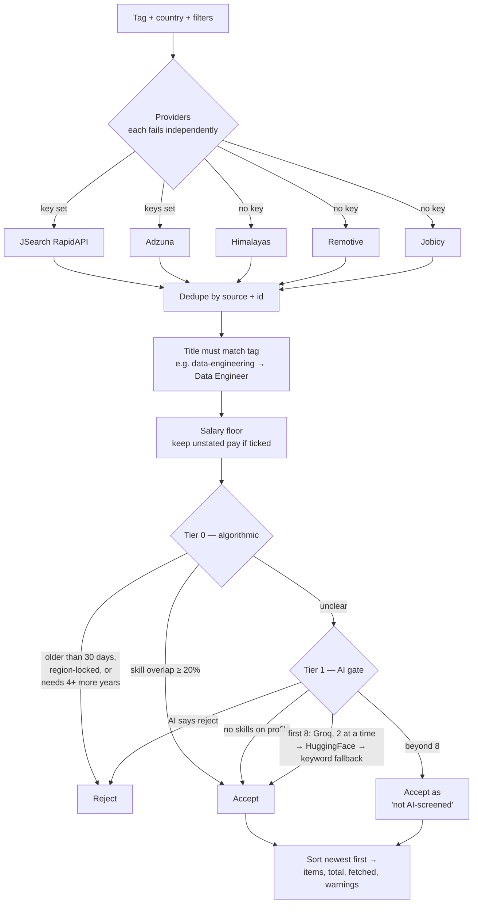
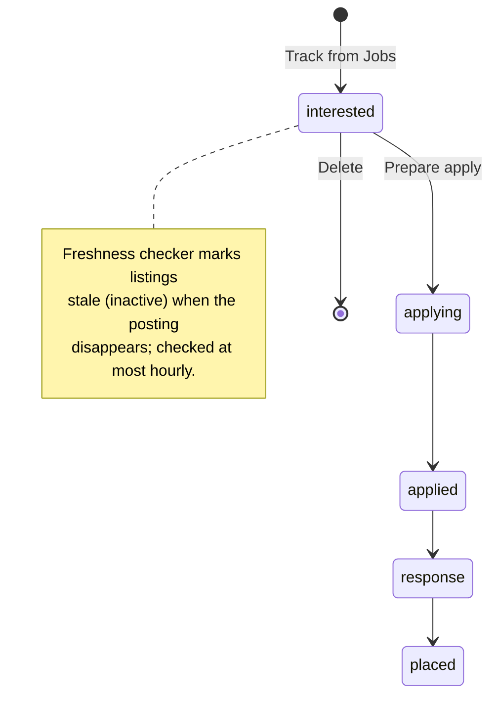

# Jobful — app workflow

Open this file in VS Code (Markdown preview) or GitHub to see the diagrams rendered.

## 1. User journey

```mermaid
flowchart TD
    A[Register<br/>/register] -->|6-digit code by email<br/>or shown on screen when SMTP is empty| B[Verify email]
    L[Login / Google SSO] --> C
    B --> C[Onboarding<br/>/onboarding]
    C --> D[Upload CV PDF<br/>POST /onboarding/upload-cv]
    D -->|Groq parses PDF text| E[Review preview:<br/>education, experience,<br/>projects, keywords, tags]
    E -->|Save details<br/>POST /onboarding/confirm-cv| F[(DB: education,<br/>experiences, projects,<br/>keywords)]
    E --> G[Pick tags<br/>PUT /onboarding/selected-tags]
    F --> H
    G --> H[Jobs page<br/>/jobs]
    H -->|select ONE tag + filters| I[Search<br/>GET /jobs/search]
    I --> J[Results bucketed:<br/>24h · 7 days · older]
    J -->|Track| K[POST /applications/track<br/>status = interested]
    K --> M[Dashboard<br/>/dashboard]
    M -->|Open application| N[/applications/:id]
    N -->|Prepare apply| O[status = applying<br/>generate CV + cover letter<br/>via Groq]
    O -->|Edit HTML, export| P[PDF<br/>POST .../documents/compile]
    P --> Q[Apply on company site]
    Q -->|update status| R[applied → response → placed]
```

## 2. Job search pipeline (`GET /api/jobs/search`)



If every provider fails, the API returns 502 with the reasons. If only some fail, results still come back and the UI shows "Some sources were skipped".

## 3. Application status lifecycle



## 4. Configuration that matters (`backend/.env`)

| Key | Needed for | Without it |
|---|---|---|
| `APP_DATABASE_URL` | everything | backend won't work |
| `GROQ_API_KEY` | CV parsing, AI gate, CV/cover letter | parsing fails; gate falls back to keywords |
| `RAPIDAPI_KEY` (subscribe to **JSearch** on RapidAPI) | JSearch / LinkedIn-style listings incl. on-site India jobs | skipped — keyless remote boards still work |
| `ADZUNA_APP_ID` / `ADZUNA_APP_KEY` | Adzuna listings | skipped |
| `SMTP_*` | real verification emails | code is returned in the API response (dev) |
| Playwright Chromium or Edge/Chrome | PDF export | 503 with the install command |
